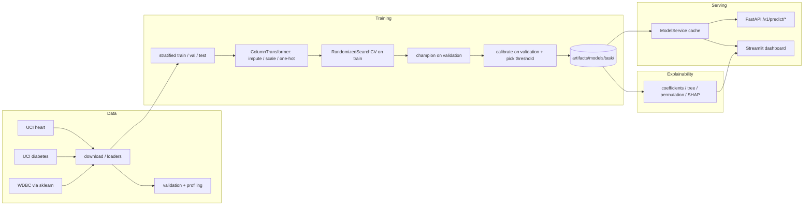

# Disease Prediction from Medical Data: An Explainable Machine Learning System

A reproducible, tested and deployable machine-learning system that estimates the
likelihood of three conditions from structured patient data, with a FastAPI
service, a Streamlit dashboard, explainability and an MLOps workflow.

> ### ⚠️ Responsible-use disclaimer
> This project is **for education and research only**. It is **not** a medical
> device, is **not clinically validated**, and must **never** be used to diagnose,
> treat, or rule out any disease or to replace a qualified healthcare
> professional. Its outputs are statistical estimates from small public
> benchmark datasets and may not generalise to any real population, hospital,
> or workflow. Never enter real patient information. See
> [`docs/responsible_use.md`](docs/responsible_use.md).

---

## 1. Overview

Three independent binary-classification tasks are implemented end to end —
data acquisition, validation and profiling, leakage-safe preprocessing, model
comparison, probability calibration, threshold selection, evaluation,
explainability, an HTTP API and a dashboard — behind one typed configuration and
artifact contract.

Nothing is hard-coded to a single dataset: each task has its own declared schema,
target convention, missing-value behaviour and model artifacts.

## 2. Problem statement and objectives

Estimate `P(condition)` from structured tabular features and return an
*explainable, honestly-evaluated* result. Objectives:

- Reproducible data pipelines with provenance (URL, licence, checksum, schema).
- No data leakage: all learned preprocessing and model selection on training data;
  decisions on validation data; the test split is touched once.
- A real baseline (DummyClassifier) so we can show whether models add value.
- Metrics beyond accuracy: sensitivity, specificity, ROC-AUC, PR-AUC, Brier,
  confusion matrices and bootstrap confidence intervals.
- Calibrated probabilities before any probability is presented as a risk.
- Explainability that is clearly distinguished from causal/medical reasoning.
- A validated API and a dashboard that share the same serving logic.

## 3. Supported prediction tasks

| Task id | Target (positive class) | Models compared |
| --- | --- | --- |
| `heart_disease` | Presence of coronary artery disease | Dummy, Logistic Regression, SVM, Random Forest, XGBoost |
| `diabetes` | Questionnaire-based diabetes risk | Dummy, Logistic Regression, SVM, Random Forest, XGBoost |
| `breast_cancer` | Malignant breast mass | Dummy, Logistic Regression, SVM, Random Forest, XGBoost |

## 4. Datasets and licences

| Task | Dataset | Rows | Source | Licence |
| --- | --- | ---: | --- | --- |
| `heart_disease` | UCI Heart Disease (Cleveland) | 303 | [UCI id 45](https://archive.ics.uci.edu/dataset/45/heart+disease) | CC BY 4.0 |
| `diabetes` | UCI Early Stage Diabetes Risk Prediction | 520 | [UCI id 529](https://archive.ics.uci.edu/dataset/529/early+stage+diabetes+risk+prediction+dataset) | CC BY 4.0 |
| `breast_cancer` | Breast Cancer Wisconsin (Diagnostic) | 569 | [UCI id 17](https://archive.ics.uci.edu/dataset/17/breast+cancer+wisconsin+diagnostic) / bundled with scikit-learn | CC BY 4.0 / BSD-3-Clause |

The Cleveland file is vendored (`data/heart+disease/`) for offline use and to
honour the dataset's publication request. The diabetes file is downloaded from
UCI and its SHA-256 recorded in `data/raw/diabetes/provenance.json`. WDBC is
loaded from scikit-learn. See [`docs/data_dictionary.md`](docs/data_dictionary.md)
for the full feature dictionary (generated from the registry) and
[`data/README.md`](data/README.md) for layout and ground rules.

## 5. Architecture



More detail, including design decisions and the drift-monitoring roadmap, is in
[`docs/architecture.md`](docs/architecture.md).

## 6. Technology stack

Python 3.11–3.12 · `uv` (env + lockfile) · pandas / NumPy · scikit-learn
(pipelines, calibration, CV) · XGBoost · SHAP · FastAPI + Uvicorn + Pydantic v2 ·
Streamlit · matplotlib · pytest · Ruff · mypy · Docker · GitHub Actions.

No GPU, Kubernetes, feature store or experiment platform — the problems here do
not justify them.

## 7. Installation

```bash
# 1) Install uv: https://docs.astral.sh/uv/getting-started/installation/
git clone https://github.com/charlesakinnurun/codealpha-disease-prediction.git
cd codealpha-disease-prediction

# 2) Create the environment and install dependencies (runtime + dev)
uv sync --extra dev

# 3) (optional) copy the example environment file
cp .env.example .env      # Windows PowerShell: Copy-Item .env.example .env
```

Requires Python 3.11+ and a normal developer machine (CPU only). Full training
of all three tasks with the default budget takes a few minutes on a laptop.

## 8. Dataset preparation

```bash
uv run python scripts/download_data.py          # fetch / verify datasets + provenance
uv run python scripts/validate_data.py          # validate, write quality reports + EDA figures
uv run python scripts/generate_docs.py          # regenerate docs/data_dictionary.md
```

## 9. Training and evaluation

```bash
# Train all tasks with configs/train.yaml (5 models incl. baseline each)
uv run python scripts/train.py

# Or target a task / budget
uv run python scripts/train.py --task heart_disease --n-iter 20 --cv 5
uv run python scripts/train.py --models dummy logistic_regression --no-save

# Independently re-derive the held-out test metrics and figures
uv run python scripts/evaluate.py
```

Outputs: fitted pipelines + metadata in `artifacts/models/<task>/`, comparison
tables in `reports/metrics/<task>_comparison.md`, metrics JSON, and figures in
`reports/figures/<task>/`.

## 10. Running the API

```bash
uv run uvicorn disease_prediction.api.main:app --port 8000
# interactive docs: http://localhost:8000/docs
```

| Method | Path | Purpose |
| --- | --- | --- |
| GET | `/health` | Liveness |
| GET | `/ready` | Readiness + which tasks have loaded models |
| GET | `/v1/models` | Available models, versions, champion flags, test metrics |
| GET | `/v1/metrics` | In-process latency / error / prediction-distribution snapshot |
| POST | `/v1/predict/heart-disease` | Predict heart disease |
| POST | `/v1/predict/diabetes` | Predict diabetes risk |
| POST | `/v1/predict/breast-cancer` | Predict malignant/benign |

`?explain=true` adds per-feature contributions.

## 11. Running the dashboard

```bash
uv run streamlit run src/disease_prediction/dashboard/app.py
# http://localhost:8501
```

The dashboard offers per-task validated inputs, a prediction panel with qualified
probability estimates and feature contributions, a performance tab with the
champion's test metrics and confusion matrix, and an "About & responsible use"
tab.

## 12. API examples

Request (**synthetic values** — never send real patient data):

```bash
curl -X POST http://localhost:8000/v1/predict/heart-disease \
  -H "Content-Type: application/json" \
  -d '{"age":57,"sex":1,"cp":4,"trestbps":130,"chol":250,"fbs":0,
       "restecg":2,"thalach":140,"exang":1,"oldpeak":1.5,
       "slope":2,"ca":0,"thal":7}'
```

Response (real output from the trained champion; ids/timestamps abbreviated):

```json
{
  "request_id": "1a96e30092e74cce9c28f4cca70fbc22",
  "task": "heart_disease",
  "model_name": "logistic_regression",
  "model_version": "0.1.0.20261012162753",
  "prediction": {"label": 1, "label_name": "1", "positive_class": 1, "negative_class": 0},
  "probability": {"positive": 0.929, "negative": 0.071, "threshold": 0.5495, "calibrated": true},
  "contributions": [
    {"feature": "ca_0.0", "contribution": -1.25333},
    {"feature": "sex", "contribution": 1.21378},
    {"feature": "cp_4.0", "contribution": 0.79172}
  ],
  "warnings": [],
  "disclaimer": "Educational and research use only. ... NOT a diagnosis. ..."
}
```

Invalid input returns a structured `422`:

```json
{"detail": {"code": "validation_error", "message": "One or more fields are missing or invalid.",
            "fields": ["cp"], "errors": [{"field": "cp", "message": "Input should be 1, 2, 3 or 4"}]}}
```

## 13. Model comparison results

Produced by `scripts/train.py` (seed 42) and re-derived by `scripts/evaluate.py`.
Champion selected by validation ROC-AUC; the reported values are on the
**untouched test split**.

### Heart disease (`heart_disease`)

| Model | CV ROC-AUC | Val ROC-AUC | Val F1 | Val Brier | Calibrated |
| --- | ---: | ---: | ---: | ---: | :---: |
| **Logistic Regression** | 0.8873 | **0.9470** | 0.8462 | 0.0912 | yes |
| SVM (RBF) | 0.8904 | 0.9405 | 0.8627 | 0.1071 | no |
| XGBoost | 0.8724 | 0.9264 | 0.8571 | 0.1117 | no |
| Random Forest | 0.8850 | 0.9113 | 0.8000 | 0.1333 | no |
| Dummy (prior) | — | 0.5000 | 0.0000 | 0.2483 | no |

**Champion test metrics (n=61):** accuracy 0.8852 · sensitivity 0.9286 ·
specificity 0.8485 · F1 0.8814 · ROC-AUC 0.9589 (95% CI 0.9110–0.9909) ·
PR-AUC 0.9530 · Brier 0.0842 · CM TN 28 / FP 5 / FN 2 / TP 26.

### Diabetes (`diabetes`)

| Model | CV ROC-AUC | Val ROC-AUC | Val F1 | Val Brier | Calibrated |
| --- | ---: | ---: | ---: | ---: | :---: |
| **SVM (RBF)** | 0.9970 | **0.9738** | 0.9697 | 0.0369 | yes |
| XGBoost | 0.9959 | 0.9629 | 0.9457 | 0.0656 | no |
| Random Forest | 0.9974 | 0.9613 | 0.9697 | 0.0529 | no |
| Logistic Regression | 0.9822 | 0.9301 | 0.9206 | 0.0923 | no |
| Dummy (prior) | — | 0.5000 | 0.7619 | 0.2367 | no |

**Champion test metrics (n=104):** accuracy 0.9712 · sensitivity 1.0000 ·
specificity 0.9250 · F1 0.9771 · ROC-AUC 0.9883 (95% CI 0.9584–1.0000) ·
PR-AUC 0.9908 · Brier 0.0220 · CM TN 37 / FP 3 / FN 0 / TP 64.
*Note the low operating threshold (0.056) — a Youden-objective artefact, not a
clinical cut-off. The dataset also contains 269 duplicate rows (52%), so treat
these numbers cautiously.*

### Breast cancer (`breast_cancer`)

| Model | CV ROC-AUC | Val ROC-AUC | Val F1 | Val Brier | Calibrated |
| --- | ---: | ---: | ---: | ---: | :---: |
| **SVM (RBF)** | 0.9941 | **0.9971** | 0.9655 | 0.0159 | yes |
| Logistic Regression | 0.9939 | 0.9964 | 0.9767 | 0.0255 | no |
| XGBoost | 0.9925 | 0.9957 | 0.9767 | 0.0265 | no |
| Random Forest | 0.9891 | 0.9902 | 0.9647 | 0.0344 | no |
| Dummy (prior) | — | 0.5000 | 0.0000 | 0.2349 | no |

**Champion test metrics (n=114):** accuracy 0.9825 · sensitivity 0.9762 ·
specificity 0.9861 · F1 0.9762 · ROC-AUC 0.9967 (95% CI 0.9872–1.0000) ·
PR-AUC 0.9954 · Brier 0.0148 · CM TN 71 / FP 1 / FN 1 / TP 41.

Every real model clearly beats the prior baseline. Full tables and rationale are
in `reports/metrics/<task>_comparison.md`; per-model cards are in
[`docs/model_card.md`](docs/model_card.md).

## 14. Explainability

Available methods (auto-selected by estimator capability):

| Method | Applies to | Notes |
| --- | --- | --- |
| Coefficients | linear models | on the transformed (scaled/one-hot) scale |
| Impurity importance | tree ensembles | biased toward high-cardinality features |
| Permutation importance | any model | computed on the original feature scale |
| SHAP | trees & linear (best-effort) | local + global mean \|SHAP\| |

Example figures generated by `scripts/evaluate.py`:
`reports/figures/<task>/champion_permutation_importance.png` and
`champion_shap_importance.png`. For the heart model, `thal`, `ca`, `cp`,
`oldpeak` and `sex` dominate.

**Caveat (repeated on purpose):** feature importance is **not** causation and not
a clinical finding, and it is unstable when inputs are correlated (as the WDBC
mean/error/worst triplets are).

## 15. Testing and CI

```bash
uv run pytest                 # full suite
uv run pytest -m "not slow"   # fast subset
uv run ruff check .           # lint
uv run ruff format --check .  # format
uv run mypy                    # type check
```

**Last verified locally:** `99 passed` (pytest), `ruff check` clean,
`ruff format --check` clean, `mypy` — no issues in 37 source files.

The suite covers unit (config, schemas, validation, features, metrics including
scikit-learn parity, inference schema, persistence, dashboard helpers), ML
(no-leakage, determinism, output contracts, baseline sanity) and integration
(training protocol, artifact reload, API endpoints incl. 422/413/503, loaders)
layers. `.github/workflows/ci.yml` runs lint, tests (with coverage), and a
data→train→evaluate→API smoke job.

## 16. Docker

```bash
docker build -t disease-prediction:latest .
# Artifacts and (read-only) data are mounted, not baked in:
docker run --rm -p 8000:8000 \
  -v "$PWD/artifacts:/app/artifacts:ro" -v "$PWD/data:/app/data:ro" \
  disease-prediction:latest
```

The image runs as a non-root user and includes a container healthcheck against
`/health`.

## 17. Known limitations and improvements

- Small, old, single-population benchmark datasets; performance will not
  transfer and is not clinically meaningful.
- No subgroup-performance analysis (insufficient data; see the model card).
- Datasets are treated as fixed snapshots; no live drift or retraining loop
  (a roadmap is documented in `docs/architecture.md`).
- SHAP local explanations reconstruct an explainer per request; caching would
  reduce latency for `?explain=true`.
- Threshold selection optimises a fixed objective; a cost-sensitive cost matrix
  would be a natural extension.
- Possible next steps: external validation, calibration on larger held-out sets,
  fairness auditing where appropriate, and an OpenTelemetry/Prometheus exporter.

## 18. Contributing and licence

Contributions are welcome — see [`CONTRIBUTING.md`](CONTRIBUTING.md) and
[`CODE_OF_CONDUCT.md`](CODE_OF_CONDUCT.md). Please keep changes reproducible and
documented, add tests, and never introduce real patient data.

Licensed under the [MIT License](LICENSE). The bundled datasets retain their own
licences (CC BY 4.0 / BSD-3-Clause); see `data/README.md`.
