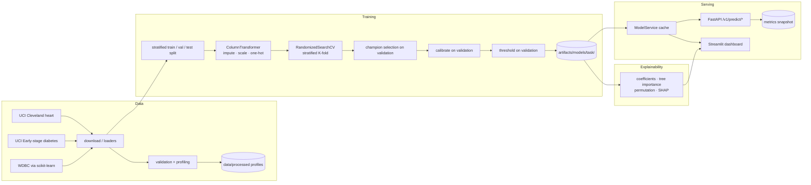

# Architecture

This document describes how the system is put together, why the main decisions
were made, and how the pieces keep the test set honest.

## High-level flow

## Layers

| Layer | Package | Responsibility |
| --- | --- | --- |
| Config | `disease_prediction.config` | Typed settings from `DP_*` env vars; path resolution. |
| Data | `disease_prediction.data` | Registry (schema/provenance), downloaders, loaders, validation, profiling, EDA figures, fingerprinting. |
| Features | `disease_prediction.features` | `ColumnTransformer` builders and the stored inference schema. |
| Models | `disease_prediction.models` | Model registry, training orchestration, artifact persistence, metadata contract. |
| Evaluation | `disease_prediction.evaluation` | Vectorised metrics, threshold selection, comparison reports, plots. |
| Explainability | `disease_prediction.explainability` | Coefficients, tree importance, permutation importance, SHAP. |
| API | `disease_prediction.api` | FastAPI app, routes, schemas, model service, middleware. |
| Dashboard | `disease_prediction.dashboard` | Streamlit UI + testable helper functions. |
| Monitoring | `disease_prediction.monitoring` | In-process counters/histograms for latency, errors, prediction distribution. |

## Key decisions and trade-offs

**Registry-driven schemas.** One declarative `DatasetSchema` per task feeds raw
validation, API request models, the dashboard form and the generated data
dictionary. Trade-off: a little more upfront modelling, but the web contract can
never silently drift from what the model was trained on.

**Preprocessing inside the pipeline.** Imputers, scalers and encoders live in the
scikit-learn `Pipeline`, so they are refit on every CV fold and never see
validation/test data. Explanation functions reach into the fitted pipeline rather
than transforming data themselves.

**Three-way split with validation-only decisions.** Model selection, calibration
and threshold tuning all use the validation split; the test split is touched once,
at the end, and only for reporting. Metrics are recomputed by
`scripts/evaluate.py` from the same seed to prove the split is reproducible.

**Vectorised metrics.** Profiling showed scikit-learn's per-call validation
dominating bootstrap CIs and threshold search under this environment. The metrics
module computes ROC-AUC (rank statistic), average precision, Brier, etc. with
NumPy; unit tests assert parity with scikit-learn within tolerance.

**Calibration on validation, honest metrics on test.** Probability calibration is
a genuine improvement for tree margins and SVM scores, but fitting it on
validation means validation metrics for the champion become optimistic — the test
metrics are the ones reported as final.

**No data in logs.** The middleware logs method, path, status, latency and a
request id, never the request body.

## Monitoring and drift (roadmap)

`/v1/metrics` exposes counters (requests, errors, validation failures), a latency
histogram and a bucketed histogram of predicted probabilities per task/model. A
production deployment would:

1. Export the registry to Prometheus/OpenTelemetry instead of an in-process dict.
2. Compare the live probability histogram and input distributions against the
   training profile in `data/processed/<task>/profile.json` (population stability
   index / KS tests) to detect covariate drift.
3. Track delayed outcome labels to monitor calibration drift.
4. Trigger retraining when drift or calibration thresholds are exceeded, after
   re-validating on a fresh split.

None of this is enabled by default, because there is no live clinical data and
inventing one would be misleading.
